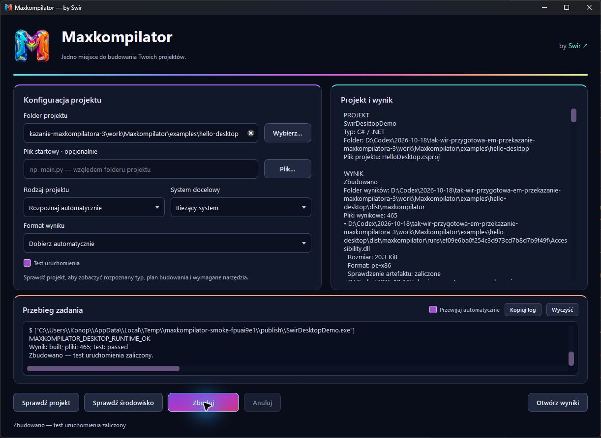

<p align="center">
  
</p>

# Maxkompilator

**One build workspace — by [Swir](https://github.com/Swir).**

*An extensible build orchestrator for desktop and Android projects. One project workflow, explicit toolchain requirements, and build results backed by evidence.*

Maxkompilator takes a project from its source folder through detection, environment checks, a build plan, execution and verified output. The first implementation covers **Python, Android and .NET**, with Windows and Android as the main delivery targets.

**Version `1.0.0`: all defined v1 criteria completed and qualified.** The engine and desktop interface integrate the preserved v6–v8 work, real .NET/Android builds, application profiles, exact tool pins, adapter API v1 and a tested remote worker protocol. Documentation is English; interface labels and build reports remain Polish. The original multicolor 3D icon is preserved.

**Verified locally:** 200 tests (196 passed, four platform-specific skips), two launches of the final packaged GUI with ten checks and five compiled workers each, real .NET console and WinForms applications, real APK/AAB builds, bundletool validation, and two APK launches on an Android emulator. An interactive Windows review also completed an actual WinForms build and reopening. Exact versions, hashes and boundaries are recorded in [release qualification](docs/RELEASE_1.0.md).

**Verified without an installed Python:** the profiled Windows EXE ran twice in an independent Windows Server Core container and read its bundled resource. Both executable hashes match the inspected build. [CI job 117747360918](https://github.com/Swir/Maxkompilator/actions/runs/39151908070/job/117747360918) passed. The Android SDK 37 compatibility fix subsequently passed the complete [15-job release workflow](https://github.com/Swir/Maxkompilator/actions/runs/39152793026).

**Release gate passed:** all 15 jobs succeeded for source commit `c39e1f1`. Production signing and additional language adapters remain outside the defined v1 scope.

[Roadmap and percentages](ROADMAP.md) · [Architecture](docs/ARCHITECTURE.md) · [Validation results](docs/VALIDATION.md) · [Verified CI jobs](docs/CI.md) · [GitHub Actions](https://github.com/Swir/Maxkompilator/actions)

## v1 progress

<!-- MAXKOMPILATOR:PROGRESS:START -->

**v1.0 progress: 100% — 100 / 100 points.**

Only completed criteria with recorded evidence earn points. Work in progress does not increase the percentage.

| Milestone | v1 weight | Earned | Milestone progress |
|---|---:|---:|---:|
| Project foundation and CI | 8 pts | 8 / 8 pts | 100% |
| Project and environment discovery | 12 pts | 12 / 12 pts | 100% |
| Python and Windows builds | 16 pts | 16 / 16 pts | 100% |
| Android: APK and AAB | 14 pts | 14 / 14 pts | 100% |
| .NET and Windows publishing | 12 pts | 12 / 12 pts | 100% |
| Desktop interface | 12 pts | 12 / 12 pts | 100% |
| Profiles and repeatable output | 10 pts | 10 / 10 pts | 100% |
| Reliability and release qualification | 10 pts | 10 / 10 pts | 100% |
| Linux and macOS runners | 4 pts | 4 / 4 pts | 100% |
| Extensibility and additional architectures | 2 pts | 2 / 2 pts | 100% |
| **Total** | **100 pts** | **100 / 100 pts** | **100%** |

Source: [docs/progress.json](docs/progress.json) · last updated: **2026-10-18**.

<!-- MAXKOMPILATOR:PROGRESS:END -->

**100% means completion of the defined v1 release.** Additional languages, installers and integrations have their own future scope. The percentage measures accepted criteria, not time remaining until release.

## Download and run the Windows application

The Windows distribution contains the GUI, its compiled CLI worker and shared runtime. In the verified v1 [GitHub Actions run](https://github.com/Swir/Maxkompilator/actions/runs/39152793026), download **`Maxkompilator-Windows-x64`**, extract the archive, and open `dist/Maxkompilator/Maxkompilator.exe`. Keep `Maxkompilator.exe`, `MaxkompilatorCLI.exe` and `_internal` together. The separately delivered portable ZIP has a top-level `Maxkompilator` folder.

The application bundle includes its Python runtime. Building your own project still requires its compiler, SDK and dependencies. The native example archives contain test applications; the GUI qualification archive contains diagnostic reports and screenshots.

## Current technology support

| Project | Detected input | Prepared output | Required environment |
|---|---|---|---|
| Python | A `.py` script or project folder | `.pyz` through zipapp; native application through PyInstaller | Python 3.11+; PyInstaller and application dependencies for native packaging |
| Android | Gradle project with an application configuration | Debug `.apk` or `.aab` | Compatible JDK, Android SDK, Gradle configuration and available project dependencies |
| .NET | A concrete `.csproj` file | `dotnet publish` output directory | A .NET SDK compatible with the project and its libraries |
| Maxkompilator GUI | Optional desktop interface | Project selection, diagnostics, plans, builds, logs and cancellation | Source GUI tested on Linux and Windows; packaged Windows GUI passed two complete launch scenarios and an interactive Windows workflow review |

Full support for C/C++, Rust, Go, Java, Flutter, Electron/Tauri and game engines is **planned**. [Remote worker v1](docs/REMOTE_WORKER.md) supports authenticated SSH, capability discovery, existing-project builds, cancellation and verified downloads. [Adapter API v1](docs/EXTENSIONS.md) supports explicitly registered trusted extensions.

## Run from source

From the repository directory, using Python 3.11 or newer:

```bash
python -m pip install .
python -m maxkompilator --help
```

The CLI engine uses the Python standard library. The GUI and PyInstaller are optional extras:

```bash
python -m pip install -c constraints-ci.txt ".[gui,freeze]"
python -m maxkompilator gui
```

These commands install Maxkompilator. Android SDK, .NET SDK and the dependencies of the application being built need their own configuration. Tool versions must match the selected project.

### Desktop interface



This is the actual Windows interface after an interactive build and successful runtime test of the self-contained WinForms example. The review used the rc1 interface; the final 1.0.0 package then passed both automated launch scenarios. [Release qualification](docs/RELEASE_1.0.md) records that distinction. [Visual identity](docs/DESIGN.md) describes the original 3D icon and dark interface.

### Inspect, diagnose and plan

```bash
python -m maxkompilator inspect ./project --json
python -m maxkompilator doctor ./project --format zipapp
python -m maxkompilator plan ./project --target native --format zipapp --json
```

`inspect` reports the detected project, `doctor` checks requirements, and `plan` describes the build. The `native` target selects the current runner's operating system and architecture. Cross-platform output requires a compatible toolchain and runner.

### Build a Python project

The repository includes `examples/hello-python`, a small example with a package and a data file:

```bash
python -m maxkompilator build ./examples/hello-python --target native --format zipapp --smoke-test
```

`--smoke-test` also runs the Python output outside the source directory. To select your own script explicitly:

```bash
python -m maxkompilator build ./project --kind python --entry main.py --target native --format zipapp
```

The default output directory is `dist/maxkompilator` inside the project. `--output` chooses another directory; relative paths are resolved from the project root. Each job report contains the exact artifact paths and runtime test result.

Use `--entry` to select an entry point and `--kind` to resolve the project type (`python`, `android` or `dotnet`). Quote paths containing spaces. Command help lists the available arguments:

```bash
python -m maxkompilator build --help
```

**A PYZ requires an installed, compatible Python interpreter.** Maxkompilator packages project sources and resources; it does not bundle the interpreter or automatically vendor external dependencies into a PYZ. See the [Python zipapp documentation](https://docs.python.org/3/library/zipapp.html) for the format and native-extension limitations.

### Native Python applications

After installing PyInstaller and the application's dependencies, native packaging uses the current operating system:

```bash
python -m maxkompilator plan ./project --kind python --entry main.py --target native --format executable --json
python -m maxkompilator build ./project --kind python --entry main.py --target native --format executable
```

The initial PyInstaller adapter creates an **application directory**. Keep all its files, including its libraries. Windows output includes an EXE; Linux and macOS produce their native formats. Changing a file extension does not change the build platform.

`--python` selects the build interpreter. Diagnostics check its OS and architecture, which must match the target and runner. The native example passed real builds, resource checks and execution outside the sources on Linux x64, Windows x64 and macOS ARM64 in the verified dev2 CI run.

### Android

The initial Android adapter requires an application module named `app` and a Gradle wrapper in the project root:

```bash
python -m maxkompilator plan ./android-app --kind android --target android --format apk --json
python -m maxkompilator build ./android-app --kind android --target android --format apk
```

`--format aab` selects a debug App Bundle. Use APK for installation on a phone. ABI and variant configuration belong to the Gradle project. The job runs `:app:clean` before building to exclude stale output, and Maxkompilator's output directory must be outside `app/build`.

The engine verifies APK structure, Gradle output metadata, compiled manifest, SHA-256 and Android SDK `apksigner` results. The included [Android example](examples/hello-android/README.md) was built, installed and launched twice on an emulator. AAB reports explicitly distinguish unsigned and JAR-signed debug output; the example's actual unsigned AAB passed independent bundletool validation and decoded-manifest checks. Neither result qualifies Play Store distribution or production signing.

### .NET

The .NET adapter accepts a concrete project with one target framework:

```bash
python -m maxkompilator plan ./dotnet-app/App.csproj --kind dotnet --target native --format directory --json
python -m maxkompilator build ./dotnet-app/App.csproj --kind dotnet --target native --format directory
```

The publish plan sets `--self-contained true`; keep the complete output directory. Add `--smoke-test` to run a copied publish directory outside the source tree. The included C# example passed actual Windows x64 publishing, runtime/resource checks and SHA-256 qualification. NativeAOT and publishing multiple frameworks need further support; WPF/WinForms require a Windows runner. The included WinForms example passed actual window, resource and self-contained desktop-dependency qualification.

### Project configuration

Store basic settings in `maxkompilator.toml` at the project root:

```toml
[project]
kind = "python"
entry = "main.py"

[build]
format = "zipapp"
target = "native"

[python]
data = ["hello/message.json"]
```

Data paths are relative to the project root. Command arguments select settings for an individual job. A complete profile editor, tool version management and signing profiles remain on the roadmap.

Application profiles support `[app]` with `name`, `version` and `icon` for Python
and Windows .NET output. `[tools]` enforces exact installed versions before build
commands. See [profile and pin rules](docs/EXTENSIONS.md),
`examples/hello-python-native/maxkompilator.toml` and
`examples/hello-desktop/maxkompilator.toml`. Automatic tool installation and
production signing are separate future features.

## Output and logs

In this table, `BASE` is `--output` or the default `dist/maxkompilator`; `UUID` identifies one job.

| Content | Location |
|---|---|
| Python archive | `BASE/project-name.pyz` |
| Native Python application or .NET publish output | `BASE/runs/UUID/` |
| Copied Android output | `BASE/artifacts/`, preserving the module path |
| Most recent job report | `BASE/build-report.json` |
| Individual job report and log | `BASE/.maxkompilator/UUID/build-report.json` and `build.log` |

Each native build receives its own output directory, so files from a previous attempt cannot satisfy a new job. An output-directory lock prevents two jobs from writing to the same destination concurrently. Reports contain the requested plan, executed plan, artifact paths, SHA-256 checksums and runtime test status.

In the CLI, `--json` leaves one report on standard output and sends build logs to standard error. `--timeout` limits each build step, while `--smoke-timeout` limits the runtime test. Ctrl+C requests job cancellation.

## Build and runtime verification

Qualification records distinguish these results:

| Result | Required evidence |
|---|---|
| Project detected | Configuration files read and an adapter selected |
| Plan prepared | Concrete runner, commands, requirements and expected output |
| Built | Successful execution and expected new output files |
| Artifact checked | Format, integrity and required metadata verified |
| Executed | A real runtime test on the specified OS or device |

Reports state which checks actually ran. An exit code of `0`, an existing file or a passing recipe test alone cannot establish that an application runs on Windows or a phone.

Automatic `--smoke-test` supports Python and native .NET output. A .NET check copies and verifies the complete publish directory before execution. Android requires an explicitly selected device; `scripts/qualify_android.py --serial ...` provides the included example's installation and runtime scenario. If a requested runtime check fails or times out, the entire job fails.

### Platform and format boundaries

- **Windows EXE through PyInstaller:** build in a suitable Windows environment. PyInstaller bundles the interpreter, and the result depends on the build OS and architecture. See [PyInstaller's operating mode](https://pyinstaller.org/en/stable/operating-mode.html).
- **Android:** initial recipes target debug variants. APKs can be installed; AABs are used for subsequent processing and distribution. Release builds require the appropriate key. See [building Android from the command line](https://developer.android.com/build/building-cmdline).
- **.NET:** runtime behavior depends on the project and publishing settings. Each application must support its selected target. See [dotnet publish](https://learn.microsoft.com/en-us/dotnet/core/tools/dotnet-publish).
- **Linux and macOS runners:** a roadmap entry does not provide a remote machine. An adapter needs a runner that satisfies the job's requirements.

Build projects you own or trust. Compilers, Gradle/MSBuild configuration and packaging hooks can execute project code with the current user's permissions. Maxkompilator orchestrates these tools; a local subprocess does not provide OS-level isolation.

## Development and quality checks

```bash
python -m unittest discover -s tests -v
python scripts/update_progress.py --check
```

The dev2 local Linux engine passed **84/84 core and integration tests**. The source GUI with the new font gate passed **8/8 groups on Linux and Windows**. The packaged Windows application passed **10/10 checks on each of two independent launches**, and all **10/10 CI jobs** succeeded. The earlier installed-wheel GUI record remains separately scoped to its seven checks before the font fix. Test counts and skips belong to their particular environment; see [docs/VALIDATION.md](docs/VALIDATION.md) and [docs/CI.md](docs/CI.md) for the exact evidence and limits.

With the `gui` extra installed, test the source GUI without a desktop:

```bash
python scripts/gui_smoke.py --screenshot build/gui-smoke.png
```

Build and qualify the native example sequentially:

```bash
python -m maxkompilator build examples/hello-python --format executable --smoke-test --json
python scripts/qualify_native.py examples/hello-python/dist/maxkompilator/build-report.json
```

Qualification compares SHA-256 and runs the application from another directory with `PYTHONPATH`/`PYTHONHOME` removed and a restricted `PATH`. This checks the example on the current system. The script also creates `native-example-TARGET.tar.gz`, preserving executable permissions and symbolic links.

CI covers Linux/Windows/macOS with Python 3.11 and 3.13, native Python builds on all three systems, and a Windows desktop bundle with an automated packaged-GUI, text-rendering and reopening gate. [docs/CI.md](docs/CI.md) records outcomes for a specific commit and distinguishes source testing, packaged GUI/worker execution and the still-open clean-machine qualification.

### Build the Windows Maxkompilator bundle

Run the packaging script in a Windows environment:

```bash
python -m pip install -c constraints-ci.txt ".[gui,freeze]"
python scripts/build_windows.py
python scripts/qualify_windows_gui.py dist/Maxkompilator/Maxkompilator.exe --output build/packaged-gui
```

The distribution is the entire `dist/Maxkompilator` folder, containing **`Maxkompilator.exe`, `MaxkompilatorCLI.exe` and their shared `_internal` directory**. The first executable opens the GUI, and the second handles console jobs. Keep the folder together.

SDKs used to build other projects remain separate tools. For example, native Python builds launched from packaged Maxkompilator require an available build interpreter and PyInstaller; select the interpreter with `--python` when needed.

### Update roadmap percentages

Update [docs/progress.json](docs/progress.json). A criterion can be `pending`, `in_progress` or `complete`; only `complete` with a nonempty `evidence` list earns its fixed weight:

```bash
python scripts/update_progress.py
```

The script regenerates the English progress blocks in README and ROADMAP. `--check` validates the weights, presence of evidence and generated content. It does not judge the truth of an evidence description: inspect the cited test or result before completing a criterion.

## Development direction

Maxkompilator has a shared GUI/CLI engine, a dark desktop interface, its own 3D icon, basic TOML configuration and readable logs. Full profiles, a multi-project queue, remote runners and API/MCP integration are subsequent steps. New technologies will join through adapters with explicit capability matrices.

The intended workflow is **project → plan → build → verified output**, with the supported environment and proof recorded for each technology.
